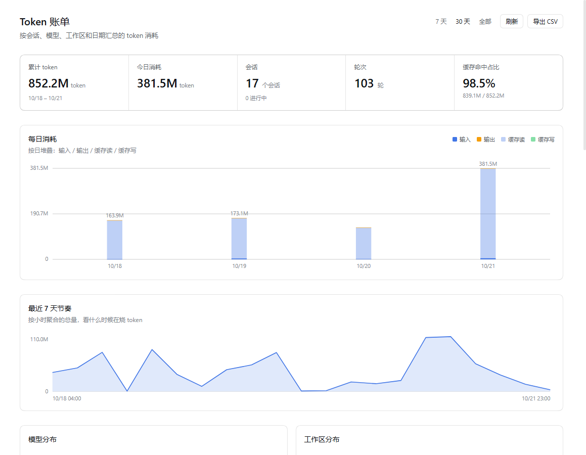

# dsh-token-bi

**Token spend dashboard for DeepSeek Harness** — collects usage scattered across every session into one board: how much burned each day, which model costs the most, which working directories spend it, how parent and child sessions split, and what each turn actually consumed.

DSH tracks token usage per session, but has no cross-session view. This plugin adds that layer, and follows the Host's own accounting so the numbers never disagree with the session view.

[中文说明](README.md) | English



---

## Contents

- [What it solves](#what-it-solves)
- [Install](#install)
- [The interface](#the-interface)
- [Where the data comes from](#where-the-data-comes-from)
- [HTTP API](#http-api)
- [Configuration](#configuration)
- [Design decisions](#design-decisions)
- [Known limitations](#known-limitations)
- [Development](#development)
- [License](#license)

---

## What it solves

After a while with DSH, a few questions come up:

- How many tokens did this month cost in total? They're spread over 20+ sessions and nothing shows a grand total.
- Which day spiked? Which task pushed it up?
- What's the cache hit rate? Easy to overlook but the biggest single factor: `cacheRead` is usually the bulk of the total, because every turn re-reads the whole context.
- When subagents work in parallel, how much belongs to the parent session and how much to the children?

This plugin folds the provider-reported usage in the session logs into those dimensions.

---

## Install

### Requirements

- DSH Desktop, or the `dsh` CLI with the Web interface
- Node.js ≥ 22.15 (session logs are zstd-compressed, which needs `zlib` zstd support)

### Install from a local checkout

There is no npm release yet; install from the repository:

```bash
git clone https://github.com/361533652/dsh-token-bi.git
dsh plugin --profile desktop add "link:/absolute/path/to/dsh-token-bi"
```

On Windows:

```powershell
dsh plugin --profile desktop add "link:E:\gitbub-project\dsh-token-bi"
```

`link:` installs a symlink, so edits in the checkout take effect without reinstalling. Afterwards, **fully quit and restart DSH Desktop** — not a page refresh. The client bundle path table is built once when the process starts.

### Verify

After restarting, the left sidebar panel list gains a **Token 账单** (Token ledger) entry, right next to **插件** (Plugins).

If it doesn't appear, check in order:

1. **Settings → Plugins → Installed plugins** — is the plugin listed and switched on?
2. `dsh --profile desktop --dump-config` — is there a row with `id: token-bi`?
3. The Host log (`%APPDATA%\DSH Desktop\logs\host\`) — search for `token-bi` and look for an activation failure.

While loading, the plugin writes `[token-bi] factory`, `[token-bi] apply` and `[token-bi] slot:xxx` to the browser console. It uses `console.error` on purpose, so the Desktop host, which only mirrors error-level console lines, records them. Those marks distinguish "the code was never downloaded" from "downloaded but not activated" from "activated but the slot registration failed".

---

## The interface

The entry is a global sidebar panel, on the same level as **Plugins** and **Scheduled tasks**. It isn't bound to a session — aggregate data belongs on the global layer.

### Headline numbers

| Metric | Meaning |
|---|---|
| Total tokens | Sum of all four token buckets in the current window |
| Today | Total for today in the local timezone |
| Sessions | Sessions in the window; the subtitle shows how many are running |
| Turns | Deduplicated turn count |
| Cache hit share | `cacheRead / total`. Usually high (80%+), meaning context is reused a lot |

### Charts

- **Daily spend** — three switchable views:
  - **Bars** (default): stacked columns split into input, cache read, cache write and output.
  - **Trend**: a line with a filled area, for reading peaks and valleys.
  - **Cumulative**: running total across the window, so the steepest days stand out.
  Every view supports hover details, and **clicking a day filters everything to it**. The chart covers every day in the current window — it is not capped at 30 days.
- **Annual activity calendar** — a GitHub-style contribution grid covering the last 365 days in five green levels. It is deliberately **independent of the time window**, and clicking a cell filters by that day too.
- **By model** — split by `provider/model`, with percentages, ranked by spend.
- **By workspace** — grouped by each session's `cwd`. Beyond eight, the rest is collapsed with a total shown, so a truncated list never reads as missing data.
- **Sessions** — the main table. Click any row to expand that session's **per-turn timeline** (one three-segment bar per turn); delegated subagents keep their nesting indent.
- **Call tree** — child sessions nested under their parent, with light and dark fills separating what the session spent itself from what its delegated children spent. Clicking a node scrolls smoothly to its table row and expands it.

### Cross-filtering

Four facets filter each other: day, model, workspace, and session state (live / archived).

Click a day column, a model bar or a workspace bar and the other cards plus the session list recompute immediately — pick a model and the workspace list narrows to the workspaces that used it, with the session totals scoped the same way.

The bar above the session table lists the active filters; each can be removed on its own, or cleared all at once.

> Jumping from the call tree into the session table clears any filter that would hide the target, so the row is always found.

### Time window

Three presets in the top right: **7 days / 30 days / All**.

Switching refetches from the Host and recomputes totals by day; it is not a client-side filter of already-loaded data. The numbers, charts and session list all change together. Quiet days stay on the axis — a 7-day window is 7 columns and a 30-day window is 30, so a few idle days never shrink the span.

### Export

**Export CSV** in the top right writes the sessions in the current window, with a UTF-8 BOM so Excel opens it without mojibake.

---

## Where the data comes from

### Sources

Two sources, merged by session id, **live sessions first**:

| Source | Reads | Purpose |
|---|---|---|
| `ctx.sessions` | Events of in-memory sessions | Sessions currently open — always current |
| `ctx.sessionQuery` | Cold persisted logs | Historical sessions, so unopened ones still count |

The plugin never reads raw `.jsonl.zstd` files; everything goes through DSH's public services.

### Accounting rules

This is the part worth explaining carefully. The rules match the Host's `tokenUsage` projection (`@deepseek-ai/dsh-token-meter`) exactly:

1. **Only provider-reported usage**, never estimated. The source is the `usage` field of an `assistant/message` event, or the last `type: 'usage'` chunk in its `stream`.
2. **A later sample for the same `(turn, step)` replaces the earlier one.** A retry produces several samples; this rule ensures the retried usage is counted once rather than accumulated.
3. **Four buckets are kept apart**: `inputTokens` / `outputTokens` / `cacheReadTokens` / `cacheWriteTokens`. The total is the sum of all four.

Rule 2 is the important one. Without replacement, sessions that hit failures and retries would report inflated numbers. To check: fold a single session and compare — all four buckets should match exactly what the session view shows.

### Time attribution

Each event is bucketed into a **local** calendar day by its timestamp. The browser passes `getTimezoneOffset()` to the Host, which uses it to bucket every record — so working across timezones, or long tasks running past midnight, still land on the right day.

### Caching

- Per-session results are cached by `(session id, revision)`, where revision is the live session's seq or the persisted session's metadata. Unchanged sessions are reused.
- The whole report is cached for 10 seconds; `refresh=1` forces a rebuild.
- The cache key includes the time window, so switching presets never serves another window's numbers.

### When it refreshes

There is no timer in the page; every rebuild is caused by something the user did:

- **Opening the bill.** The host mounts the page when the panel is opened and unmounts it when you switch away, so a mount *is* "just opened" — it asks for `refresh=1`, because the first number you see should be the number at the moment you looked, not a 10-second-old cache entry.
- **Switching 7 days / 30 days / all.** Also a forced rebuild, so the preset you just clicked never shows a snapshot taken before the click.
- **Coming back to the window** (`visibilitychange` / `focus`): one rebuild on the way back in; nothing is sent while the window is in the background.
- The **Refresh** button at the top, for anything else.

Left open and untouched, the numbers simply sit still — an open panel costs nothing in the background.

---

## HTTP API

The plugin registers one prefix route on the Host; the browser reads it with same-origin requests.

```
GET /api/dsh-token-bi/report?offset=<minutes>&days=<window>&refresh=1
GET /api/dsh-token-bi/session?id=<session id>&offset=<minutes>
```

| Parameter | Meaning |
|---|---|
| `offset` | Browser timezone offset in minutes; defaults to the Host's |
| `days` | Window in days; `0` or `all` means everything |
| `refresh` | `1` skips the 10-second cache |

`report` returns:

```jsonc
{
  "generatedAt": 1792500000000,
  "offsetMinutes": 480,
  "rangeDays": 30,
  "cutoffDay": "2026-09-22",   // first day of the window; omitted for "all"
  "totals": { "input": 0, "output": 0, "cacheRead": 0, "cacheWrite": 0, "total": 0,
              "sessions": 0, "live": 0, "turns": 0, "steps": 0 },
  "sessions": [ /* per session: id/title/cwd/parentSession/totals/models/days/... */ ],
  "models":   [ /* provider/model totals */ ],
  "days":     [ /* by day, with missing days zero-filled */ ],
  "hours":    [ /* hourly, last 7 days */ ],
  "cwds":     [ /* by working directory */ ],
  "cells":    [ /* day × model × cwd cross-tab backing the facet filters */ ],
  "errors":   [ /* sessions that failed to read; they never block the report */ ]
}
```

`session` returns one session's per-turn `rows` (`turn/step/time/input/output/cacheRead/cacheWrite/total`), fetched lazily when a row is expanded — so a long history never slows the first paint.

> The route uses the `webServer` prefix registration that DSH plugins normally use. **Note** it is registered once per process and a reload swaps the handler rather than registering again: a duplicate registration makes `webServer` throw and fails the whole plugin's activation. That is a real bug hit during development, and `test/reload.mjs` guards against it.

---

## Configuration

**There is none.** Every option (time window, filters) is switched in the UI; nothing goes into the profile config.

The plugin occupies a single row in a profile:

```yaml
- insert:
    - id: token-bi
      name: dsh-token-bi
```

---

## Design decisions

A few deliberate choices, written down so they aren't changed casually:

**Aggregates live on a global panel, not inside a session.** Cross-session data placed in a single-session surface is a category error; users would read it as "this session's stats".

**Read the log, write nothing.** The plugin appends no session events and keeps no database of its own. The session log is the single source of truth; any derived data must be a rebuildable cache.

**Match the Host's accounting instead of inventing a formula.** Users compare the plugin's numbers against the session view. Disagreeing with the Host is worse than being slightly imprecise.

**No cost estimation.** Prices vary enormously across providers, models and cache strategies; a hardcoded price table would convey false precision. For money spent, read the provider's billing.

**No settings page.** Nothing is configurable, so a settings page would add an entry that does nothing.

---

## Known limitations

- **Only steps that report usage are counted.** If a provider returns no usage, that step is invisible to the statistics. That isn't undercounting; there is nothing to count.
- **Compacted history still counts.** The numbers describe the log, not the currently visible context. Messages that were compacted away still belong to the session's total, which matches the intuition of "what did this conversation cost" but is a different question from "how large is the current context".
- **Child sessions are accounted separately.** A parent's numbers **exclude** its delegated children. The call tree shows both levels, and only the sum is the cost of the whole subtree.
- **Very long sessions truncate the per-turn list.** An expanded row shows at most the latest 60 turns, so a huge session doesn't slow rendering. Totals are unaffected.
- **Only the local machine.** The plugin reads the local DSH session store; on multiple machines, check each one.
- **Requires the Web surface.** It depends on the `webServer` service and will not activate under a TUI-only profile.

---

## Development

### Layout

```
index.js              Host half: registers the HTTP route
lib/collector.mjs     Aggregation: merges live and persisted sessions into a report
lib/usage.mjs         Accounting: folds one session log into usage rows (pure, no IO)
lib/client.js         Browser half: panel registration, page and charts
cordis.patch.yml      Bundle patch: inserts the Host row
locale/{zh,en}.json   Plugin metadata (title, description, icon)
test/                 Offline tests, see below
```

`lib/usage.mjs` is a pure module — no filesystem, no Cordis — so it can be called with any array of events. The accounting rules live there; change them only alongside a test.

### Tests

```bash
npm test              # locale parity, reload race, slot registration, page render
npm run test:store    # fold the local session store (read-only)
npm run test:route    # drive the Host route with a stub context
```

| Test | Covers | Needs |
|---|---|---|
| `locale-check.cjs` | zh/en define the same keys; every key passed to `t()` exists | nothing |
| `reload.mjs` | a hot reload never double-registers the route (regression: this once made the plugin vanish) | nothing |
| `slots.mjs` | registration against the real `SlotCore`, and no settings page | `DSH_APP_DIR` |
| `render.mjs` | renders the page through a minimal hooks runtime, including the expand interaction | local session store |
| `harness.mjs` | human-readable aggregation dump | local session store |
| `route.mjs` | the route's 200/400/404 behaviour and JSON contract | local session store |

Tests read `$DSH_HOME/sessions` (`~/.dsh/sessions` by default); override with `DSH_SESSIONS` or a command-line argument. With no history they produce an empty report rather than failing.

`slots.mjs` needs the `@deepseek-ai/dsh-client-ui-slots` package shipped with DSH:

```bash
DSH_APP_DIR="E:\dsh\DSH Desktop\resources\app" npm test
```

When it can't be found, that test prints `SKIP` and exits 0 — it never fakes a pass.

### Notes for contributors

- **`lib/client.js` must not `require` DSH client packages** such as `ui-primitives`. Write controls and styles yourself, or copy the Host's implementation under your own class prefix, referencing only `--dsw-alias-*` theme tokens.
- **Styles must use theme tokens**, or dark mode breaks.
- **`dsh.client.inject` takes package names** (e.g. `@deepseek-ai/dsh-client-ui-renderer`), not runtime service names like `slots`. Getting this wrong leaves the module stuck in loading and drags the whole page into "Failed to load plugins".
- **The client entry belongs at `lib/client.js`**, matching the rest of the ecosystem.

---

## License

[MIT](LICENSE)
